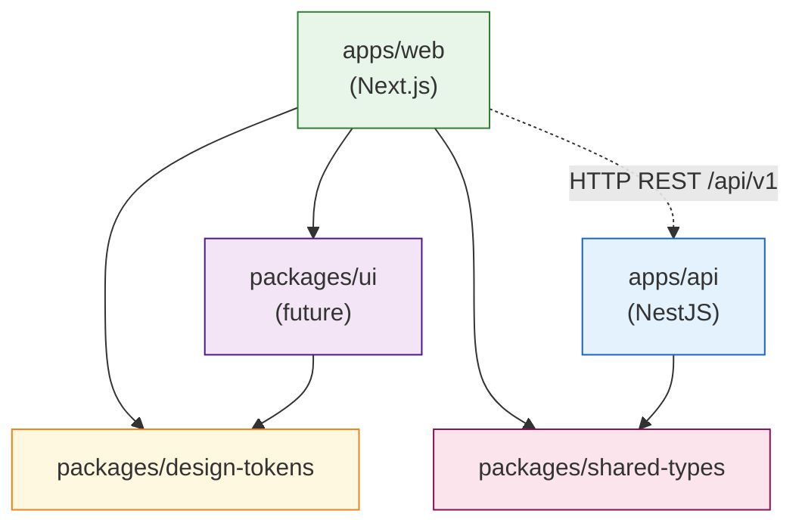
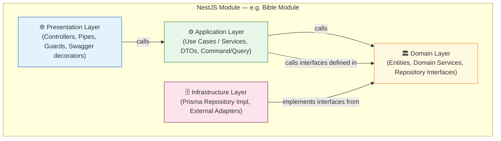
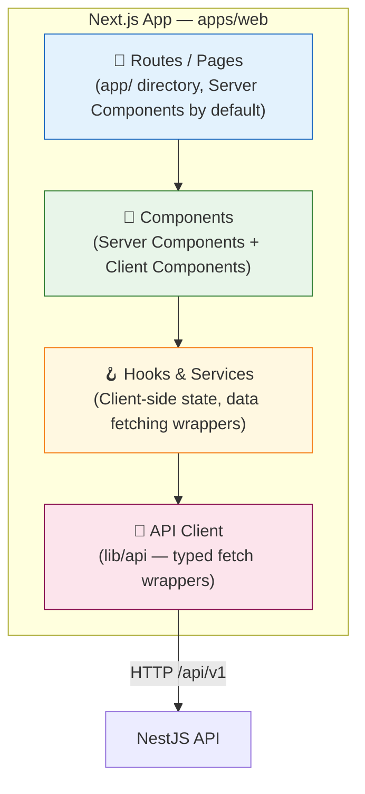
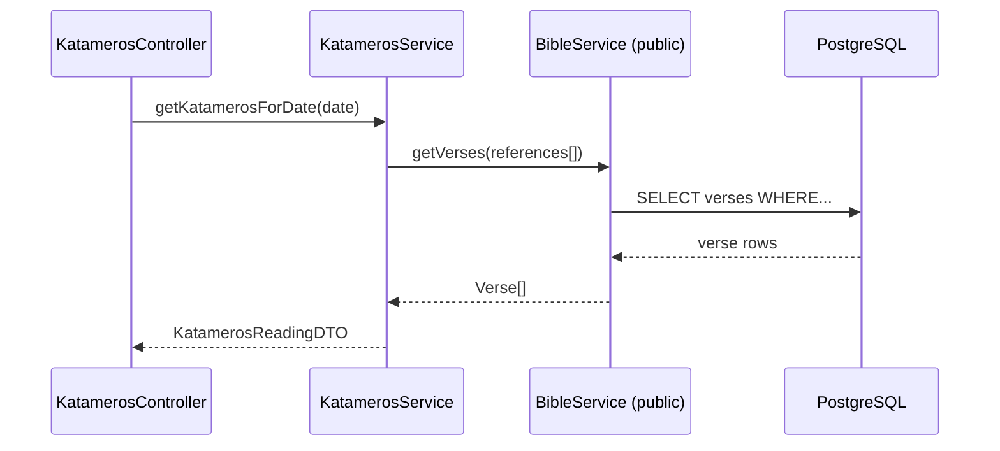
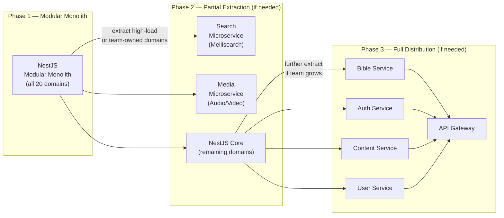

# Architecture Overview — Ana Orthodox Platform

**Document Purpose:** Defines the overall architecture of the Ana Orthodox platform, its structure, layer design, communication patterns, and key architectural decisions.
**Last Updated:** 2026-11-17
**Status:** ACTIVE
**Owner:** Architecture Team
**Related Documents:** [DOMAIN_BOUNDARIES.md](./DOMAIN_BOUNDARIES.md) · [SYSTEM_CONTEXT.md](./SYSTEM_CONTEXT.md) · [DATA_FLOW.md](./DATA_FLOW.md) · [decisions/ADR-0001.md](./decisions/ADR-0001.md)

---

## Table of Contents

1. [Architecture Style](#1-architecture-style)
2. [Monorepo Structure](#2-monorepo-structure)
3. [Backend Layer Architecture (NestJS)](#3-backend-layer-architecture-nestjs)
4. [Frontend Layer Architecture (Next.js)](#4-frontend-layer-architecture-nextjs)
5. [Communication Design](#5-communication-design)
6. [Key Architectural Decisions](#6-key-architectural-decisions)
7. [Scalability Path](#7-scalability-path)
8. [Technology Stack Summary](#8-technology-stack-summary)

---

## 1. Architecture Style

### Modular Monolith

Ana Orthodox is built as a **Modular Monolith** deployed as a single application. Each of the 20 product domains is encapsulated as an independent NestJS module with clean, well-defined boundaries.

**Why not microservices?**  
See [ADR-0001](./decisions/ADR-0001.md) for the full decision record. The short answer: single team, greenfield project, complex content domain, faster iteration — microservices overhead is not justified at this stage.

**Why not a classic layered monolith?**  
Domain boundaries are enforced at the module level. Cross-domain access is restricted to explicit public APIs (service interfaces), preventing the spaghetti coupling that causes big-ball-of-mud systems.

### Core Principles

| Principle                   | Implementation                                                                                       |
| --------------------------- | ---------------------------------------------------------------------------------------------------- |
| **Domain isolation**        | Each domain owns its own NestJS module, controllers, services, and DB entities                       |
| **Clean module boundaries** | Cross-module calls go through public service interfaces only — never direct DB access across modules |
| **Content-first**           | The vast majority of content (Bible, Katameros, Hymns, Calendar, etc.) is public and read-heavy      |
| **RTL/Arabic-first**        | All UI decisions start from RTL; LTR is a future adaptation                                          |
| **PWA-first**               | Offline capability is a first-class feature, not an afterthought                                     |
| **Extractability**          | Module boundaries are designed so any module can become an independent microservice later            |

---

## 2. Monorepo Structure

The repository is organized as a **pnpm / Turborepo monorepo**.

```
ana-orthodox/
├── apps/
│   ├── web/                    # Next.js 15 App Router (PWA)
│   │   ├── app/                # App Router directory (layouts, pages, loading, error)
│   │   │   ├── (public)/       # Public content routes — no auth required
│   │   │   ├── (auth)/         # Auth routes (login, register)
│   │   │   └── (dashboard)/    # Authenticated user routes
│   │   ├── components/         # App-specific UI components
│   │   ├── hooks/              # Custom React hooks
│   │   ├── lib/                # API client, utilities, formatters
│   │   ├── public/             # Static assets, PWA manifest, icons
│   │   ├── styles/             # Global CSS, RTL overrides
│   │   ├── next.config.ts      # Next.js configuration
│   │   └── package.json
│   │
│   └── api/                    # NestJS application
│       ├── src/
│       │   ├── modules/        # 20 domain modules live here
│       │   │   ├── bible/
│       │   │   ├── katameros/
│       │   │   ├── hymns/
│       │   │   └── ...         # (one directory per domain)
│       │   ├── core/           # Shared core (guards, interceptors, filters, decorators)
│       │   ├── infrastructure/ # Cross-cutting infra (Prisma, config, logging)
│       │   └── main.ts         # Application bootstrap
│       ├── prisma/
│       │   ├── schema.prisma   # Prisma schema (all models)
│       │   └── migrations/     # Migration history
│       └── package.json
│
├── packages/
│   ├── design-tokens/          # Material 3 tokens, Coptic theme variables
│   │   ├── src/
│   │   │   ├── tokens.ts       # Base token definitions
│   │   │   ├── coptic-theme.ts # Ana Orthodox color/typography theme
│   │   │   └── index.ts
│   │   └── package.json
│   │
│   ├── shared-types/           # DTOs, interfaces, enums shared between web and api
│   │   ├── src/
│   │   │   ├── dto/            # Request/response DTOs
│   │   │   ├── enums/          # Shared enumerations
│   │   │   └── index.ts
│   │   └── package.json
│   │
│   └── ui/                     # (Future) Shared React component library
│       ├── src/
│       │   └── components/     # RTL-ready, Material 3-based components
│       └── package.json
│
├── docs/
│   ├── architecture/           # This document and siblings
│   ├── database/               # DB design, entity catalog, migration history
│   ├── api/                    # API contracts, authorization matrix, error standards
│   └── project/                # Project manifest, status, audit
│
├── .github/
│   ├── workflows/              # CI/CD pipelines (GitHub Actions)
│   └── PULL_REQUEST_TEMPLATE.md
│
├── turbo.json                  # Turborepo pipeline configuration
├── pnpm-workspace.yaml         # Workspace definition
├── package.json                # Root workspace package.json
└── .env.example                # Example environment variables
```

### Package Dependency Rules



> [!IMPORTANT]
> `apps/api` must **never** import from `apps/web`, and vice versa. All shared code lives in `packages/*`. The only runtime link between apps is the HTTP REST API.

---

## 3. Backend Layer Architecture (NestJS)

Each domain module follows a strict **Clean Architecture** layer pattern. Dependencies flow inward only — outer layers depend on inner layers, never the reverse.



### Layer Responsibilities

#### Presentation Layer

- **NestJS Controllers**: Map HTTP routes to use cases
- **Request Pipes**: Input validation (`class-validator`, `class-transformer`)
- **Guards**: JWT auth guard, roles guard, throttle guard
- **Interceptors**: Response transformation, logging
- **Swagger decorators**: `@ApiOperation`, `@ApiResponse`, etc.
- **DTOs**: Request/Response data transfer objects (can be in `shared-types` package when needed by web)

#### Application Layer

- **Use Case Services**: One service per domain feature (e.g. `GetBibleChapterUseCase`, `SearchBibleUseCase`)
- **Orchestration**: Coordinates domain entities and repository calls; may call other domain module public services
- **Command / Query separation** (optional CQRS for high-read domains)
- **No business logic leakage** into controllers

#### Domain Layer

- **Entities**: TypeScript classes representing core business objects (pure, no framework dependencies)
- **Value Objects**: Immutable types for domain concepts (e.g. `VerseReference`, `CopticDate`)
- **Domain Services**: Logic that spans multiple entities within the same domain
- **Repository Interfaces**: TypeScript interfaces (`IBibleRepository`) — the domain declares _what_ it needs; infrastructure _implements_ it

#### Infrastructure Layer

- **Prisma Repository Implementations**: Implement repository interfaces using Prisma client
- **External Service Adapters**: Any third-party API integrations (future: push notifications, Bible APIs)
- **Database configurations**: Prisma service, connection management
- **Caching adapters**: Redis or in-memory cache (future)

### Module Directory Structure

```
src/modules/bible/
├── bible.module.ts                  # NestJS module declaration
├── presentation/
│   └── bible.controller.ts          # REST endpoints
├── application/
│   ├── use-cases/
│   │   ├── get-book.use-case.ts
│   │   ├── get-chapter.use-case.ts
│   │   └── search-bible.use-case.ts
│   └── bible.service.ts             # Public service (exposed to other modules)
├── domain/
│   ├── entities/
│   │   ├── book.entity.ts
│   │   ├── chapter.entity.ts
│   │   └── verse.entity.ts
│   ├── value-objects/
│   │   └── verse-reference.value-object.ts
│   └── repositories/
│       └── bible.repository.interface.ts
└── infrastructure/
    └── repositories/
        └── prisma-bible.repository.ts
```

---

## 4. Frontend Layer Architecture (Next.js)

The Next.js App Router application follows a layered structure aligned with App Router conventions and React Server Components.



### Layer Responsibilities

#### Routes / Pages (`app/` directory)

- **Server Components** by default — data fetched server-side, no client JS shipped
- **Layout files** (`layout.tsx`): RTL html wrapper (`<html lang="ar" dir="rtl">`), theme providers
- **Loading files** (`loading.tsx`): Suspense-based streaming skeletons
- **Error files** (`error.tsx`): Error boundaries per route segment
- **Route Groups**: `(public)`, `(auth)`, `(dashboard)` — logical grouping without URL impact

#### Components

- **Server Components**: Data-coupled components that fetch their own data server-side (e.g. `BibleChapterDisplay`)
- **Client Components**: Interactive components marked with `'use client'` (e.g. search box, bookmark button, audio player)
- **Shared UI**: From `packages/ui` (design-system components)
- All components must support RTL layout; Material 3 components used throughout

#### Hooks & Services

- **Custom hooks**: Data-fetching hooks using SWR or React Query for client-side mutations
- **State management**: Zustand for client-side global state (reading progress, offline queue)
- **Service workers**: Registered from `public/sw.js`, managed via `next-pwa` or custom

#### API Client (`lib/api/`)

- Typed fetch wrappers matching `shared-types` DTOs
- Handles: auth headers, error normalization, language header (`Accept-Language`)
- Base URL: configured via `NEXT_PUBLIC_API_URL` env var

### App Router Directory Structure

```
app/
├── layout.tsx                    # Root layout: <html lang="ar" dir="rtl">
├── (public)/
│   ├── layout.tsx                # Public layout (header, footer, no auth)
│   ├── bible/
│   │   ├── page.tsx              # Bible home
│   │   └── [bookId]/
│   │       └── [chapterId]/
│   │           └── page.tsx      # Chapter view (SSR)
│   ├── katameros/
│   ├── hymns/
│   ├── calendar/
│   └── ...                       # Other content domains
├── (auth)/
│   ├── login/page.tsx
│   └── register/page.tsx
└── (dashboard)/
    ├── layout.tsx                # Auth-required layout
    ├── bookmarks/page.tsx
    ├── notes/page.tsx
    └── reading-plans/page.tsx
```

---

## 5. Communication Design

### REST API

| Attribute | Value                                          |
| --------- | ---------------------------------------------- |
| Protocol  | HTTP/HTTPS                                     |
| Base path | `/api/v1`                                      |
| Format    | JSON (`Content-Type: application/json`)        |
| Auth      | Bearer JWT (`Authorization: Bearer <token>`)   |
| Language  | `Accept-Language: ar` (default), `en`, `cop`   |
| Docs      | `/api/docs` (Swagger UI via `@nestjs/swagger`) |

### Request/Response Envelope

All API responses use a standard envelope:

```typescript
// Success
{
  "data": T,
  "meta": {
    "timestamp": "ISO8601",
    "version": "v1",
    "pagination"?: { "cursor": string, "hasMore": boolean, "total"?: number }
  }
}

// Error
{
  "error": {
    "code": "ANA-1001",
    "message": "الآية المطلوبة غير موجودة",
    "details": []
  },
  "meta": { "timestamp": "ISO8601", "version": "v1" }
}
```

### Inter-Module Communication (Server-Side)

Within the monolith, domain modules communicate via **NestJS dependency injection** — module A imports module B's public service:



> [!IMPORTANT]
> Cross-module access is **only** through the public service layer. Infrastructure (Prisma repositories) is **never** shared across module boundaries. Each module queries only its own tables.

---

## 6. Key Architectural Decisions

### RTL-First, Arabic-First

- `<html lang="ar" dir="rtl">` on the root layout — not a toggle, the default
- All CSS written assuming RTL; LTR override is a future concern
- Material 3 components used with `direction: rtl` context
- Typography: **Noto Naskh Arabic** as primary font (excellent Arabic readability), **Noto Sans Coptic** for Coptic script rendering
- All 20 domain names and UI strings have Arabic as the primary locale

See [ADR-0003](./decisions/ADR-0003.md).

### PWA-First

- Service Worker registered at root, managing cache strategies per content type
- **Cache-first** for static content (Bible text, Katameros, Hymns audio)
- **Network-first** for dynamic content (events, user-specific data)
- **Stale-while-revalidate** for semi-static content (Synaxarium entries, calendar)
- IndexedDB via `idb` library for structured offline data
- Web App Manifest: icons, theme color, display: `standalone`
- Installable on Android/iOS/Desktop

### Content-First, Public-First

Most content in Ana Orthodox is public (read-only, no auth required):

- Bible text, Katameros, Liturgical readings
- Hymns (text + future audio)
- Agpeya / Prayer hours
- Synaxarium entries
- Coptic/Liturgical calendar
- Church Fathers / Patristic Library
- Church History, Coptic Heritage
- Churches Directory, Monasteries Directory

Only user-specific features require authentication:

- Bookmarks, personal notes
- Reading plans and progress
- Event registrations (future)

This design maximizes SEO value and content accessibility.

### Editorial Workflow

Editors can create, update, and publish content through an admin interface. Content has a `status` field (`DRAFT`, `PUBLISHED`, `ARCHIVED`). Only `PUBLISHED` content is returned by public APIs. This applies to:

- Synaxarium entries
- Commentary and study materials
- Church events

### SSR for SEO

All public content pages are Server-Side Rendered or Statically Generated via Next.js:

- Bible chapters: Static generation (ISR) — content changes rarely
- Synaxarium: SSR by date
- Calendar: Static generation per year
- Churches/Monasteries: ISR

This ensures Coptic Orthodox content is indexed by search engines and discoverable.

---

## 7. Scalability Path

The modular monolith is designed with explicit extraction points. When load or team scale requires it, any domain module can be promoted to a standalone microservice.



### Extraction Preconditions

A domain module is ready for extraction when:

1. It has **zero circular dependencies** on other modules (enforced from day 1)
2. All cross-module calls are through **typed service interfaces**
3. The module owns its **own database tables** (no shared table access)
4. The module has its **own test suite**

---

## 8. Technology Stack Summary

| Category                   | Technology             | Version    | Notes                   |
| -------------------------- | ---------------------- | ---------- | ----------------------- |
| **Frontend Framework**     | Next.js                | 15         | App Router, RSC         |
| **Frontend Language**      | TypeScript             | 5.x        | Strict mode             |
| **UI Library**             | Material 3 (MUI)       | Latest     | RTL configured          |
| **CSS**                    | CSS Modules + Tailwind | —          | RTL utilities           |
| **State Management**       | Zustand                | Latest     | Client state            |
| **Data Fetching (client)** | SWR / React Query      | Latest     | Mutations, cache        |
| **Backend Framework**      | NestJS                 | 10+        | Modular                 |
| **Backend Language**       | TypeScript             | 5.x        | Strict mode             |
| **Runtime**                | Node.js                | LTS (v22+) | —                       |
| **Database**               | PostgreSQL             | 16         | —                       |
| **ORM**                    | Prisma                 | 5.x        | Schema-first            |
| **Auth**                   | Passport + JWT         | —          | Access + refresh tokens |
| **Validation**             | class-validator        | Latest     | DTO validation          |
| **API Docs**               | @nestjs/swagger        | Latest     | OpenAPI 3               |
| **Monorepo**               | Turborepo + pnpm       | Latest     | —                       |
| **PWA**                    | next-pwa / custom SW   | —          | Workbox                 |
| **Testing**                | Vitest + Jest          | —          | Unit + integration      |
| **E2E Testing**            | Playwright             | Latest     | —                       |
| **CI/CD**                  | GitHub Actions         | —          | —                       |
| **Linting**                | ESLint + Prettier      | Latest     | Shared config           |
| **Fonts**                  | Noto Naskh Arabic      | —          | Primary                 |
| **Fonts**                  | Noto Sans Coptic       | —          | Coptic script           |

---

_Document maintained by the Architecture Team. Update when architectural decisions change — always accompany structural changes with a new ADR._
