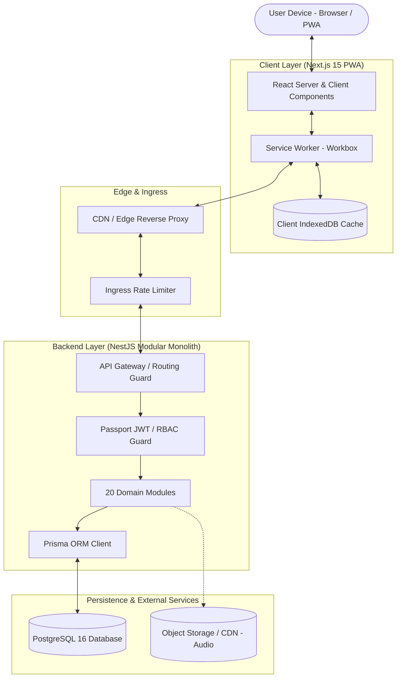

# DATA_FLOW.md

**Purpose:** Document end-to-end data transmission, transformation, and caching flows across the Ana Orthodox platform.  
**Scope:** Client (PWA), Edge/CDN, Backend API (NestJS), Persistence (PostgreSQL / Redis / IndexedDB)  
**Status:** APPROVED  
**Last Updated:** 2026-11-17  
**Owner:** Architecture Agent  
**Related Documents:** ARCHITECTURE.md, SYSTEM_CONTEXT.md, DOMAIN_BOUNDARIES.md, OFFLINE_STRATEGY.md

---

## 1. High-Level Data Flow Topology

---

## 2. Core Operational Data Flows

### Flow 1: Public Canonical Content Retrieval (e.g., Reading Bible or Katameros)

1. **Request:** User navigates to `/bible/genesis/1` or `/katameros/today`.
2. **Client Evaluation:**
   - Next.js RSC (React Server Component) evaluates cache headers.
   - PWA Service Worker checks cache-first policy in CacheStorage / IndexedDB.
   - If found locally, immediately renders within < 50ms without network round-trip.
3. **Cache Miss & Origin Fetch:**
   - Request dispatched to `GET /api/v1/bible/books/genesis/chapters/1`.
   - Traverses Cloudflare CDN / Edge caching layer (Stale-While-Revalidate: 86400s).
   - Ingress applies anonymous rate limiting (`100 req/min`).
4. **Backend Processing:**
   - NestJS Global Validation Pipe validates parameters.
   - `BibleModule` -> `BibleService.getChapterWithVerses(book, chapter)`.
   - Prisma executes parameterized SQL with joined verses and cross-references.
5. **Persistence & Return:**
   - PostgreSQL executes index scan on `(book_id, chapter_number)`.
   - Response enveloped as standard DTO `{ data: { book, chapter, verses: [...] }, meta: { timestamp, canonVersion } }`.
   - Service Worker updates IndexedDB asynchronously.

---

### Flow 2: Authenticated Personal Data Mutex (e.g., Saving a Verse Bookmark or Note)

1. **User Action:** User taps bookmark/note on verse 1:3 (`BTN-BIBLE-BOOKMARK`).
2. **Client Optimistic Mutation:**
   - UI reflects bookmarked state instantly.
   - Action dispatched to `useVerseBookmark` React hook.
3. **Transport & Security:**
   - HTTPS POST to `/api/v1/user/bookmarks`.
   - Header: `Authorization: Bearer <access_token>`.
4. **Backend Auth & Domain Verification:**
   - NestJS `JwtAuthGuard` validates token signature, expiration, and user revokability status.
   - `UserBookmarksModule` -> `BookmarksService.createBookmark(userId, verseId)`.
   - Unique compound constraint `@@unique([user_id, verse_id])` checked.
5. **Database Transaction:**
   - PostgreSQL inserts into `user_bookmarks` with `created_at` timestamp and user ownership ID.
6. **Error / Offline Recovery:**
   - If network offline: Service Worker queues mutation in IndexedDB Sync Queue; resumes upon `online` event via Background Sync.

---

### Flow 3: Editorial Publishing & Invalidation Pipeline

1. **Editor Action:** Editor submits an approved Synaxarium commemoration update at `/admin/synaxarium/edit`.
2. **Authorization Enforcement:**
   - Request sent to `PUT /api/v1/admin/synaxarium/:id`.
   - `RolesGuard` verifies user holds `EDITOR` or `ADMINISTRATOR` role and `synaxarium.update` permission.
3. **Validation & Versioning:**
   - Synaxarium update DTO verified against strict schema (Arabic text sanitization, liturgical day format).
   - Domain audit log recorded in database (`admin_audit_logs`).
4. **Cache Invalidation:**
   - Cache tag `synaxarium-cache-tag` purged across CDN and Redis cache layer.
   - Broadcast event triggers Next.js `revalidatePath('/synaxarium/[date]')`.

---

### Flow 4: Media Streaming Data Flow (Coptic Hymns & Liturgical Audio)

1. **Client Audio Request:** User initiates playback of a Pascha hymn (`AppHymnPlayer`).
2. **Metadata Fetch:**
   - Client queries `GET /api/v1/hymns/:id` to retrieve hymn metadata, Coptic/Arabic lyrics, and signed audio URL.
3. **Audio Content Delivery:**
   - Media byte-range requests (`Range: bytes=0-`) stream directly from Object Storage CDN (Cloudflare R2 / AWS S3) to bypass backend server load.
   - Offline caching: If user taps "Save Offline" (`BTN-HYMN-DOWNLOAD`), audio blob is downloaded into dedicated IndexedDB media store (`ana_orthodox_media_cache`).
