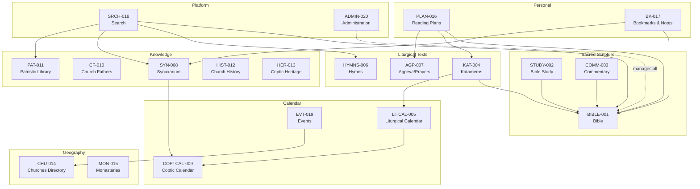
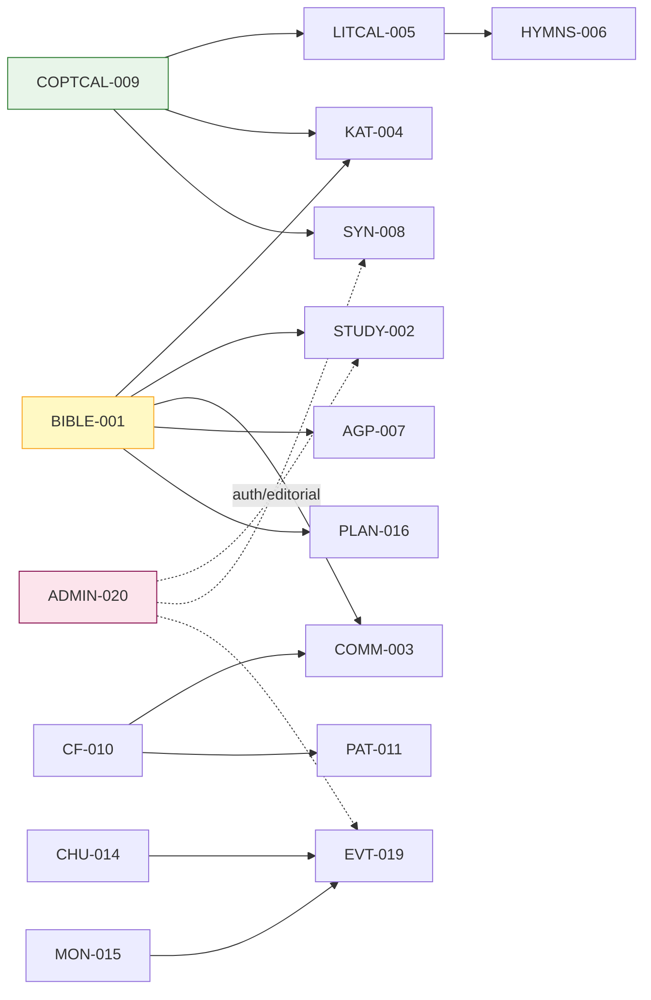

# Domain Boundaries — Ana Orthodox Platform

**Document Purpose:** Defines the module boundaries for all 20 product domains. Each domain is an isolated NestJS module with its own responsibility, data ownership, and public API surface.
**Last Updated:** 2026-11-17
**Status:** ACTIVE — All modules PLANNED (Phase 0)
**Owner:** Architecture Team
**Related Documents:** [ARCHITECTURE.md](./ARCHITECTURE.md) · [DATA_FLOW.md](./DATA_FLOW.md) · [../database/ENTITY_CATALOG.md](../database/ENTITY_CATALOG.md)

---

## Boundary Rules

Before the domain catalog, these rules govern **all** module boundaries without exception:

| Rule                       | Description                                                                                                                                |
| -------------------------- | ------------------------------------------------------------------------------------------------------------------------------------------ |
| **Own your data**          | A module reads and writes only the database tables it owns. No cross-module DB access.                                                     |
| **Public API only**        | Cross-module calls happen only through the module's declared public service interface.                                                     |
| **No circular deps**       | Module A may depend on Module B, but not if Module B also depends on Module A.                                                             |
| **Explicit contracts**     | DTOs crossing module boundaries live in `packages/shared-types`.                                                                           |
| **Domain events (future)** | For loosely-coupled side effects, domain events via an in-process event bus (NestJS EventEmitter) are preferred over direct service calls. |

---

## Domain Map



---

## Module Catalog

---

### BIBLE-001 — Bible Module

| Attribute         | Value         |
| ----------------- | ------------- |
| **Module ID**     | BIBLE-001     |
| **NestJS Module** | `BibleModule` |
| **Status**        | PLANNED       |

**Responsibility:**  
Owns all canonical scripture content — books, chapters, and verses of the Bible. Provides read access to verse content in multiple translations (Arabic, Coptic, English). The Bible is the foundation layer that many other modules reference.

**Data Ownership:**

| Table                | Description                                                            |
| -------------------- | ---------------------------------------------------------------------- |
| `bible_translations` | Available Bible translations (e.g. Smith-Van Dyke Arabic, Coptic, KJV) |
| `bible_books`        | 66 canonical books + Deuterocanonical books, ordered by canon          |
| `bible_chapters`     | Chapters per book                                                      |
| `bible_verses`       | Individual verses with text content per translation                    |

**Dependencies:**  
_None_ — Bible is a foundational module with no upstream dependencies.

**Public API Surface:**

```typescript
// BibleService — importable by other NestJS modules
getBook(bookId: string): Promise<Book>
getChapter(bookId: string, chapterNum: number, translationId?: string): Promise<Chapter>
getVerse(ref: VerseReference, translationId?: string): Promise<Verse>
getVerses(refs: VerseReference[], translationId?: string): Promise<Verse[]>
getChapterRange(bookId: string, fromChapter: number, toChapter: number): Promise<Chapter[]>
listBooks(options?: ListBooksOptions): Promise<Book[]>
listTranslations(): Promise<Translation[]>
```

**REST Endpoints (Presentation layer):**

- `GET /api/v1/bible/books`
- `GET /api/v1/bible/books/:bookId`
- `GET /api/v1/bible/books/:bookId/chapters/:chapterNum`
- `GET /api/v1/bible/books/:bookId/chapters/:chapterNum/verses`
- `GET /api/v1/bible/translations`

---

### STUDY-002 — Bible Study Module

| Attribute         | Value              |
| ----------------- | ------------------ |
| **Module ID**     | STUDY-002          |
| **NestJS Module** | `BibleStudyModule` |
| **Status**        | PLANNED            |

**Responsibility:**  
Provides structured Bible study materials: thematic studies, guided readings, discussion questions, and study series. References Bible verses via BIBLE-001.

**Data Ownership:**

| Table              | Description                                |
| ------------------ | ------------------------------------------ |
| `study_series`     | Collections of related study sessions      |
| `study_sessions`   | Individual study session with content      |
| `study_verse_refs` | Verse references associated with a session |

**Dependencies:**

- `BIBLE-001` (BibleService) — to resolve verse references
- `ADMIN-020` (editorial workflow — PUBLISHED status)

**Public API Surface:**

```typescript
getStudySeries(id: string): Promise<StudySeries>
getStudySession(id: string): Promise<StudySession>
listStudySeries(options: PaginationOptions): Promise<StudySeries[]>
```

**REST Endpoints:**

- `GET /api/v1/bible-study/series`
- `GET /api/v1/bible-study/series/:id`
- `GET /api/v1/bible-study/sessions/:id`

---

### COMM-003 — Commentary Module

| Attribute         | Value              |
| ----------------- | ------------------ |
| **Module ID**     | COMM-003           |
| **NestJS Module** | `CommentaryModule` |
| **Status**        | PLANNED            |

**Responsibility:**  
Provides patristic and modern commentary on specific Bible passages. Associates commentary entries with verse ranges. Distinct from the Patristic Library (which covers complete works).

**Data Ownership:**

| Table                | Description                                           |
| -------------------- | ----------------------------------------------------- |
| `commentaries`       | Commentary collections (e.g. Coptic Synod commentary) |
| `commentary_entries` | Individual commentary entry with verse range and text |
| `commentary_authors` | Authors/sources of commentary entries                 |

**Dependencies:**

- `BIBLE-001` (BibleService) — verse reference resolution
- `CF-010` (ChurchFathersService) — linking commentary to Church Father authors

**Public API Surface:**

```typescript
getCommentariesForVerse(ref: VerseReference): Promise<CommentaryEntry[]>
getCommentariesForRange(from: VerseReference, to: VerseReference): Promise<CommentaryEntry[]>
```

**REST Endpoints:**

- `GET /api/v1/commentary?book=:bookId&chapter=:ch&verse=:v`
- `GET /api/v1/commentary/:id`

---

### KAT-004 — Katameros Module

| Attribute         | Value             |
| ----------------- | ----------------- |
| **Module ID**     | KAT-004           |
| **NestJS Module** | `KatamerosModule` |
| **Status**        | PLANNED           |

**Responsibility:**  
Provides the Katameros (Lectionary) — the annual cycle of daily liturgical Bible readings for the Coptic Orthodox Church. Each day in the Coptic calendar maps to specific readings (Pauline, Catholic, Acts, Psalms, Gospel, Synaxar).

**Data Ownership:**

| Table                | Description                                         |
| -------------------- | --------------------------------------------------- |
| `katameros_entries`  | Daily lectionary entry keyed by Coptic date         |
| `katameros_readings` | Individual reading within a day (type + verse refs) |

**Dependencies:**

- `BIBLE-001` (BibleService) — resolve and return actual verse content
- `COPTCAL-009` (CopticCalendarService) — Coptic date resolution

**Public API Surface:**

```typescript
getKatamerosForDate(gregorianDate: Date): Promise<KatamerosDay>
getKatamerosForCopticDate(copticDate: CopticDate): Promise<KatamerosDay>
```

**REST Endpoints:**

- `GET /api/v1/katameros/today`
- `GET /api/v1/katameros/:gregorianDate` (YYYY-MM-DD)
- `GET /api/v1/katameros/coptic/:copticYear/:copticMonth/:copticDay`

---

### LITCAL-005 — Liturgical Calendar Module

| Attribute         | Value                      |
| ----------------- | -------------------------- |
| **Module ID**     | LITCAL-005                 |
| **NestJS Module** | `LiturgicalCalendarModule` |
| **Status**        | PLANNED                    |

**Responsibility:**  
Manages the Coptic Orthodox liturgical calendar — fasts, feasts, holy days, saints' commemoration days, and liturgical seasons. Maps Gregorian dates to their liturgical significance.

**Data Ownership:**

| Table                       | Description                                   |
| --------------------------- | --------------------------------------------- |
| `liturgical_seasons`        | Seasons (Great Lent, Advent, Pentecost, etc.) |
| `liturgical_feasts`         | Fixed and movable feasts with Gregorian rules |
| `liturgical_fasts`          | Fasting periods with rules                    |
| `liturgical_commemorations` | Daily saint/martyr commemorations             |

**Dependencies:**

- `COPTCAL-009` (CopticCalendarService) — Coptic-Gregorian date conversion

**Public API Surface:**

```typescript
getLiturgicalDayInfo(date: Date): Promise<LiturgicalDay>
getLiturgicalSeason(date: Date): Promise<LiturgicalSeason>
listUpcomingFeasts(from: Date, days: number): Promise<Feast[]>
isFastingDay(date: Date): Promise<boolean>
```

**REST Endpoints:**

- `GET /api/v1/liturgical-calendar/today`
- `GET /api/v1/liturgical-calendar/:date`
- `GET /api/v1/liturgical-calendar/feasts`
- `GET /api/v1/liturgical-calendar/fasts`

---

### HYMNS-006 — Hymns Module

| Attribute         | Value         |
| ----------------- | ------------- |
| **Module ID**     | HYMNS-006     |
| **NestJS Module** | `HymnsModule` |
| **Status**        | PLANNED       |

**Responsibility:**  
Library of Coptic Orthodox liturgical hymns. Each hymn has text in Arabic/Coptic/Greek/English, associated seasons/feasts, and future audio assets. Hymns are linked to liturgical occasions.

**Data Ownership:**

| Table          | Description                                |
| -------------- | ------------------------------------------ |
| `hymns`        | Hymn records (name, occasion, voice type)  |
| `hymn_texts`   | Multi-language text content per hymn       |
| `hymn_seasons` | Linking hymns to liturgical seasons/feasts |
| `hymn_audio`   | (Future) audio file references per hymn    |

**Dependencies:**

- `LITCAL-005` (LiturgicalCalendarService) — filtering hymns by season/occasion

**Public API Surface:**

```typescript
getHymn(id: string): Promise<Hymn>
listHymns(filters: HymnFilters): Promise<Hymn[]>
listHymnsForOccasion(occasionId: string): Promise<Hymn[]>
```

**REST Endpoints:**

- `GET /api/v1/hymns`
- `GET /api/v1/hymns/:id`
- `GET /api/v1/hymns?season=:seasonId&occasion=:occasionId`

---

### AGP-007 — Agpeya / Prayers Module

| Attribute         | Value          |
| ----------------- | -------------- |
| **Module ID**     | AGP-007        |
| **NestJS Module** | `AgpeyaModule` |
| **Status**        | PLANNED        |

**Responsibility:**  
The Agpeya (Coptic Book of Hours) and other standard Coptic Orthodox prayers. Provides the seven prayer hours with their psalms, readings, and prayers. Also covers common prayers (Liturgy of St. Basil, etc.).

**Data Ownership:**

| Table             | Description                                      |
| ----------------- | ------------------------------------------------ |
| `prayer_books`    | Collections (Agpeya, Liturgy of St. Basil, etc.) |
| `prayer_hours`    | The seven canonical prayer hours                 |
| `prayer_sections` | Sections within a prayer hour                    |
| `prayer_texts`    | Multi-language text for each section             |

**Dependencies:**

- `BIBLE-001` (BibleService) — psalms and Bible readings embedded in Agpeya

**Public API Surface:**

```typescript
getPrayerHour(hour: PrayerHourEnum): Promise<PrayerHour>
listPrayerHours(): Promise<PrayerHourSummary[]>
getPrayerBook(id: string): Promise<PrayerBook>
```

**REST Endpoints:**

- `GET /api/v1/agpeya/hours`
- `GET /api/v1/agpeya/hours/:hour`
- `GET /api/v1/prayers`
- `GET /api/v1/prayers/:id`

---

### SYN-008 — Synaxarium Module

| Attribute         | Value              |
| ----------------- | ------------------ |
| **Module ID**     | SYN-008            |
| **NestJS Module** | `SynaxariumModule` |
| **Status**        | PLANNED            |

**Responsibility:**  
The Synaxarium (Coptic Martyrology / Book of Saints). Each Coptic calendar day lists the saints, martyrs, and events commemorated on that day. Synaxarium entries are editorial content (require PUBLISHED status).

**Data Ownership:**

| Table                     | Description                             |
| ------------------------- | --------------------------------------- |
| `synaxarium_entries`      | Daily entries keyed by Coptic month/day |
| `synaxarium_saints`       | Individual saint records with biography |
| `synaxarium_entry_saints` | Join table linking days to saints       |

**Dependencies:**

- `COPTCAL-009` (CopticCalendarService) — date mapping
- `ADMIN-020` — editorial PUBLISHED status gate

**Public API Surface:**

```typescript
getSynaxariumForDate(gregorianDate: Date): Promise<SynaxariumDay>
getSynaxariumForCopticDate(copticDate: CopticDate): Promise<SynaxariumDay>
getSaint(id: string): Promise<Saint>
```

**REST Endpoints:**

- `GET /api/v1/synaxarium/today`
- `GET /api/v1/synaxarium/:gregorianDate`
- `GET /api/v1/synaxarium/saints/:id`

---

### COPTCAL-009 — Coptic Calendar Module

| Attribute         | Value                  |
| ----------------- | ---------------------- |
| **Module ID**     | COPTCAL-009            |
| **NestJS Module** | `CopticCalendarModule` |
| **Status**        | PLANNED                |

**Responsibility:**  
Provides Coptic calendar date conversion (Gregorian ↔ Coptic), Coptic month/day names in Arabic and Coptic, and calendar metadata. This is a foundational utility module used by many others.

**Data Ownership:**

| Table           | Description                                                |
| --------------- | ---------------------------------------------------------- |
| `coptic_months` | The 13 Coptic months with names in all supported languages |

> [!NOTE]
> Coptic date conversion is primarily algorithmic (not table-driven). The CopticCalendarService exposes conversion functions used by LITCAL-005, SYN-008, KAT-004, and others.

**Dependencies:**  
_None_ — foundational utility module.

**Public API Surface:**

```typescript
gregorianToCoptic(date: Date): CopticDate
copticToGregorian(copticDate: CopticDate): Date
getCopticMonthName(month: number, language: 'ar' | 'cop' | 'en'): string
getCopticYear(gregorianDate: Date): number
```

**REST Endpoints:**

- `GET /api/v1/coptic-calendar/convert?date=YYYY-MM-DD`
- `GET /api/v1/coptic-calendar/today`
- `GET /api/v1/coptic-calendar/months`

---

### CF-010 — Church Fathers Module

| Attribute         | Value                 |
| ----------------- | --------------------- |
| **Module ID**     | CF-010                |
| **NestJS Module** | `ChurchFathersModule` |
| **Status**        | PLANNED               |

**Responsibility:**  
Biographical and theological profiles of the Church Fathers, with emphasis on the Coptic and Alexandrian tradition (St. Athanasius, St. Cyril, St. Mark, Pope Shenouda III, etc.).

**Data Ownership:**

| Table                 | Description                                              |
| --------------------- | -------------------------------------------------------- |
| `church_fathers`      | Father profiles (name, era, feast day, biography)        |
| `church_father_works` | Listing of known works by each father (links to PAT-011) |

**Dependencies:**  
_None_ (stand-alone). PAT-011 may reference CF-010 to link works to authors.

**Public API Surface:**

```typescript
getChurchFather(id: string): Promise<ChurchFather>
listChurchFathers(filters: ChurchFatherFilters): Promise<ChurchFather[]>
```

**REST Endpoints:**

- `GET /api/v1/church-fathers`
- `GET /api/v1/church-fathers/:id`

---

### PAT-011 — Patristic Library Module

| Attribute         | Value                    |
| ----------------- | ------------------------ |
| **Module ID**     | PAT-011                  |
| **NestJS Module** | `PatristicLibraryModule` |
| **Status**        | PLANNED                  |

**Responsibility:**  
Full texts of patristic works — homilies, treatises, letters, and theological writings. Linked to Church Father authors from CF-010.

**Data Ownership:**

| Table                | Description                                         |
| -------------------- | --------------------------------------------------- |
| `patristic_works`    | Individual works with metadata and author reference |
| `patristic_chapters` | Chapter/section breakdown of works                  |
| `patristic_texts`    | Multi-language text content per chapter             |

**Dependencies:**

- `CF-010` (ChurchFathersService) — author information

**Public API Surface:**

```typescript
getWork(id: string): Promise<PatristicWork>
getWorkChapter(workId: string, chapterId: string): Promise<PatristicChapter>
listWorks(filters: PatristicFilters): Promise<PatristicWork[]>
```

**REST Endpoints:**

- `GET /api/v1/patristic-library/works`
- `GET /api/v1/patristic-library/works/:id`
- `GET /api/v1/patristic-library/works/:id/chapters/:chapterId`

---

### HIST-012 — Church History Module

| Attribute         | Value                 |
| ----------------- | --------------------- |
| **Module ID**     | HIST-012              |
| **NestJS Module** | `ChurchHistoryModule` |
| **Status**        | PLANNED               |

**Responsibility:**  
Historical articles and timelines covering the history of the Coptic Orthodox Church — from St. Mark's evangelization of Egypt, through the Christological councils, the Arabic period, to modern times.

**Data Ownership:**

| Table               | Description                                   |
| ------------------- | --------------------------------------------- |
| `history_articles`  | Long-form historical articles with metadata   |
| `history_timelines` | Timeline events with dates and descriptions   |
| `history_popes`     | List of Coptic Popes (Pope 1 through present) |

**Dependencies:**  
_None_

**Public API Surface:**

```typescript
getHistoryArticle(id: string): Promise<HistoryArticle>
listHistoryArticles(filters: HistoryFilters): Promise<HistoryArticle[]>
getPope(id: string): Promise<CoticPope>
listPopes(): Promise<CopticPope[]>
```

**REST Endpoints:**

- `GET /api/v1/church-history/articles`
- `GET /api/v1/church-history/articles/:id`
- `GET /api/v1/church-history/popes`
- `GET /api/v1/church-history/popes/:id`
- `GET /api/v1/church-history/timeline`

---

### HER-013 — Coptic Heritage Module

| Attribute         | Value                  |
| ----------------- | ---------------------- |
| **Module ID**     | HER-013                |
| **NestJS Module** | `CopticHeritageModule` |
| **Status**        | PLANNED                |

**Responsibility:**  
Language, art, music, and cultural heritage of the Coptic people — Coptic script lessons, Coptic language resources, iconography guides, Coptic art history.

**Data Ownership:**

| Table                     | Description                                 |
| ------------------------- | ------------------------------------------- |
| `heritage_articles`       | Cultural and heritage articles              |
| `coptic_language_lessons` | Structured Coptic language learning content |
| `coptic_glossary`         | Coptic-Arabic-English glossary entries      |

**Dependencies:**  
_None_

**Public API Surface:**

```typescript
getHeritageArticle(id: string): Promise<HeritageArticle>
listHeritageArticles(filters: HeritageFilters): Promise<HeritageArticle[]>
listGlossaryEntries(prefix?: string): Promise<GlossaryEntry[]>
```

**REST Endpoints:**

- `GET /api/v1/coptic-heritage/articles`
- `GET /api/v1/coptic-heritage/articles/:id`
- `GET /api/v1/coptic-heritage/glossary`

---

### CHU-014 — Churches Directory Module

| Attribute         | Value            |
| ----------------- | ---------------- |
| **Module ID**     | CHU-014          |
| **NestJS Module** | `ChurchesModule` |
| **Status**        | PLANNED          |

**Responsibility:**  
Directory of Coptic Orthodox churches worldwide — name, address, diocese, mass schedule, contact information, and location coordinates.

**Data Ownership:**

| Table                   | Description                                   |
| ----------------------- | --------------------------------------------- |
| `churches`              | Church records with location and contact info |
| `church_dioceses`       | Diocese/eparchy hierarchy                     |
| `church_mass_schedules` | Scheduled liturgies per church                |

**Dependencies:**  
_None_

**Public API Surface:**

```typescript
getChurch(id: string): Promise<Church>
listChurches(filters: ChurchFilters): Promise<Church[]>
findChurchesNearby(lat: number, lng: number, radiusKm: number): Promise<Church[]>
listDioceses(): Promise<Diocese[]>
```

**REST Endpoints:**

- `GET /api/v1/churches`
- `GET /api/v1/churches/:id`
- `GET /api/v1/churches/nearby?lat=&lng=&radius=`
- `GET /api/v1/churches/dioceses`

---

### MON-015 — Monasteries Module

| Attribute         | Value               |
| ----------------- | ------------------- |
| **Module ID**     | MON-015             |
| **NestJS Module** | `MonasteriesModule` |
| **Status**        | PLANNED             |

**Responsibility:**  
Directory and information about Coptic Orthodox monasteries worldwide — history, patron saint, location, visiting information, and monastic community details.

**Data Ownership:**

| Table                     | Description                                              |
| ------------------------- | -------------------------------------------------------- |
| `monasteries`             | Monastery records with history and location              |
| `monastery_patron_saints` | Patron saints of each monastery (refs SYN-008 saint IDs) |

**Dependencies:**  
_None_ (may reference SYN-008 saint IDs for patron saints — loose coupling via IDs, not service calls)

**Public API Surface:**

```typescript
getMonastery(id: string): Promise<Monastery>
listMonasteries(filters: MonasteryFilters): Promise<Monastery[]>
```

**REST Endpoints:**

- `GET /api/v1/monasteries`
- `GET /api/v1/monasteries/:id`

---

### PLAN-016 — Reading Plans Module

| Attribute         | Value                |
| ----------------- | -------------------- |
| **Module ID**     | PLAN-016             |
| **NestJS Module** | `ReadingPlansModule` |
| **Status**        | PLANNED              |

**Responsibility:**  
Structured reading plans (Bible in a year, Great Lent plan, Agpeya reading schedule). Tracks user progress through each plan. Requires authentication.

**Data Ownership:**

| Table                   | Description                                   |
| ----------------------- | --------------------------------------------- |
| `reading_plans`         | Plan definitions with schedule                |
| `reading_plan_days`     | Daily reading assignments per plan            |
| `user_reading_progress` | User's progress (completed days, current day) |

**Dependencies:**

- `BIBLE-001` (BibleService) — verse references in plans
- `KAT-004` (KatamerosService) — Katameros plans
- `AGP-007` (AgpeyaService) — Agpeya reading plans
- **Auth required** for user progress tracking

**Public API Surface:**

```typescript
getReadingPlan(id: string): Promise<ReadingPlan>
listReadingPlans(): Promise<ReadingPlan[]>
// Auth-required:
getUserProgress(userId: string, planId: string): Promise<ReadingProgress>
markDayComplete(userId: string, planId: string, day: number): Promise<void>
```

**REST Endpoints:**

- `GET /api/v1/reading-plans`
- `GET /api/v1/reading-plans/:id`
- `GET /api/v1/reading-plans/:id/progress` _(auth)_
- `POST /api/v1/reading-plans/:id/progress` _(auth)_

---

### BK-017 — Bookmarks & Notes Module

| Attribute         | Value             |
| ----------------- | ----------------- |
| **Module ID**     | BK-017            |
| **NestJS Module** | `BookmarksModule` |
| **Status**        | PLANNED           |

**Responsibility:**  
User-specific bookmarks and personal notes attached to any content item in the platform (Bible verses, Synaxarium entries, hymns, etc.). Requires authentication. All data is user-private.

**Data Ownership:**

| Table       | Description                                         |
| ----------- | --------------------------------------------------- |
| `bookmarks` | User bookmarks with content reference (polymorphic) |
| `notes`     | User personal notes with optional content reference |

**Dependencies:**

- **Auth required** (all operations scoped to authenticated user)
- Cross-domain references stored as polymorphic keys (content_type + content_id)

**Public API Surface:**

```typescript
// All methods scoped to userId
createBookmark(userId: string, item: BookmarkTarget): Promise<Bookmark>
deleteBookmark(userId: string, bookmarkId: string): Promise<void>
listBookmarks(userId: string, filters: BookmarkFilters): Promise<Bookmark[]>
createNote(userId: string, note: CreateNoteDTO): Promise<Note>
updateNote(userId: string, noteId: string, update: UpdateNoteDTO): Promise<Note>
deleteNote(userId: string, noteId: string): Promise<void>
listNotes(userId: string, filters: NoteFilters): Promise<Note[]>
```

**REST Endpoints:**

- `GET /api/v1/bookmarks` _(auth)_
- `POST /api/v1/bookmarks` _(auth)_
- `DELETE /api/v1/bookmarks/:id` _(auth)_
- `GET /api/v1/notes` _(auth)_
- `POST /api/v1/notes` _(auth)_
- `PATCH /api/v1/notes/:id` _(auth)_
- `DELETE /api/v1/notes/:id` _(auth)_

---

### SRCH-018 — Search Module

| Attribute         | Value          |
| ----------------- | -------------- |
| **Module ID**     | SRCH-018       |
| **NestJS Module** | `SearchModule` |
| **Status**        | PLANNED        |

**Responsibility:**  
Platform-wide search across all public content. Phase 1: PostgreSQL full-text search with Arabic stemming. Future: Meilisearch or Elasticsearch for fuzzy and semantic search.

**Data Ownership:**

| Table          | Description                              |
| -------------- | ---------------------------------------- |
| `search_index` | (Future) Denormalized search index table |

> [!NOTE]
> Phase 1 search uses PostgreSQL `tsvector` / `tsquery` with Arabic (`arabic`) text search configuration, querying domain tables directly. The Search module orchestrates cross-domain queries.

**Dependencies:**

- `BIBLE-001`, `HYMNS-006`, `SYN-008`, `PAT-011`, `CF-010`, `HIST-012`, `HER-013` (read-only, search within their content)

**Public API Surface:**

```typescript
search(query: SearchQuery): Promise<SearchResults>
```

**REST Endpoints:**

- `GET /api/v1/search?q=:query&domains=:domains&page=:page`

---

### EVT-019 — Events Module

| Attribute         | Value          |
| ----------------- | -------------- |
| **Module ID**     | EVT-019        |
| **NestJS Module** | `EventsModule` |
| **Status**        | PLANNED        |

**Responsibility:**  
Church events — conferences, retreats, liturgical celebrations, youth events. Linked to churches and monasteries. Editors create/manage events; anonymous users can browse.

**Data Ownership:**

| Table              | Description                                     |
| ------------------ | ----------------------------------------------- |
| `events`           | Event records with date, location, type, status |
| `event_organizers` | Organizing church/entity references             |

**Dependencies:**

- `CHU-014` (ChurchesService) — linking events to church locations
- `MON-015` (MonasteriesService) — events at monasteries
- `ADMIN-020` — editorial workflow

**Public API Surface:**

```typescript
getEvent(id: string): Promise<Event>
listEvents(filters: EventFilters): Promise<Event[]>
listUpcomingEvents(limit: number): Promise<Event[]>
```

**REST Endpoints:**

- `GET /api/v1/events`
- `GET /api/v1/events/upcoming`
- `GET /api/v1/events/:id`
- `POST /api/v1/events` _(editor/admin)_
- `PATCH /api/v1/events/:id` _(editor/admin)_

---

### ADMIN-020 — Administration Module

| Attribute         | Value                  |
| ----------------- | ---------------------- |
| **Module ID**     | ADMIN-020              |
| **NestJS Module** | `AdministrationModule` |
| **Status**        | PLANNED                |

**Responsibility:**  
Platform administration — user management, role assignment, content moderation, editorial workflow (approve/reject/publish content), system configuration. All endpoints require ADMINISTRATOR role.

**Data Ownership:**

| Table              | Description                                               |
| ------------------ | --------------------------------------------------------- |
| `users`            | User account records                                      |
| `roles`            | Role definitions (ANONYMOUS, USER, EDITOR, ADMINISTRATOR) |
| `user_roles`       | User ↔ role assignments                                   |
| `permissions`      | Fine-grained permission records                           |
| `role_permissions` | Role ↔ permission assignments                             |
| `refresh_tokens`   | JWT refresh token storage                                 |
| `audit_logs`       | Administrative action audit trail                         |
| `editorial_queue`  | Content pending editorial review                          |

> [!IMPORTANT]
> The `users` table is owned by ADMIN-020. The Auth module (part of ADMIN-020 or a sibling `AuthModule`) reads from this table for authentication. No other module may query the `users` table directly.

**Dependencies:**  
_No upstream domain dependencies_ — all other modules may depend on Auth guards/decorators from this module.

**Public API Surface (for use by guards/decorators):**

```typescript
// AuthService — used by JWT strategy
findUserById(id: string): Promise<User | null>
findUserByEmail(email: string): Promise<User | null>
validateRefreshToken(userId: string, token: string): Promise<boolean>
// RolesService — used by roles guard
getUserRoles(userId: string): Promise<Role[]>
hasPermission(userId: string, permission: string): Promise<boolean>
```

**REST Endpoints:**

- `POST /api/v1/auth/login`
- `POST /api/v1/auth/register`
- `POST /api/v1/auth/refresh`
- `POST /api/v1/auth/logout`
- `GET /api/v1/admin/users` _(admin)_
- `GET /api/v1/admin/users/:id` _(admin)_
- `PATCH /api/v1/admin/users/:id/roles` _(admin)_
- `GET /api/v1/admin/editorial-queue` _(editor/admin)_
- `POST /api/v1/admin/editorial-queue/:id/publish` _(editor/admin)_

---

## Dependency Summary



---

_All modules are PLANNED as of 2026-11-17 (Phase 0 — Foundation). Module status will be updated as development progresses._
