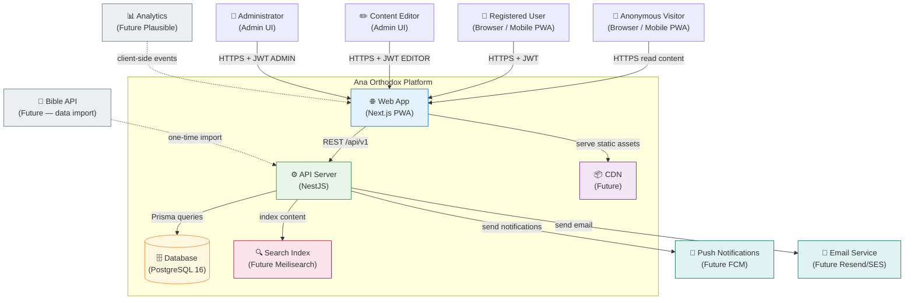
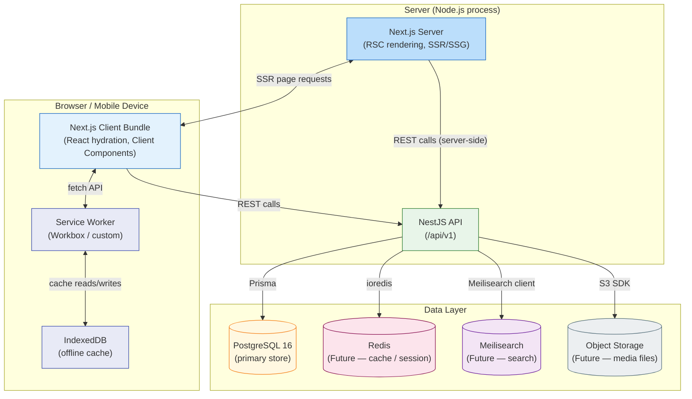

# System Context — Ana Orthodox Platform

**Document Purpose:** Describes the system boundary of Ana Orthodox, the external actors who interact with it, and the external systems it depends on or integrates with. Provides context for architectural decisions.
**Last Updated:** 2026-11-17
**Status:** ACTIVE
**Owner:** Architecture Team
**Related Documents:** [ARCHITECTURE.md](./ARCHITECTURE.md) · [DATA_FLOW.md](./DATA_FLOW.md) · [DOMAIN_BOUNDARIES.md](./DOMAIN_BOUNDARIES.md)

---

## Table of Contents

1. [System Boundary](#1-system-boundary)
2. [External Actors (Users)](#2-external-actors-users)
3. [External Systems](#3-external-systems)
4. [Internal Subsystems](#4-internal-subsystems)
5. [System Context Diagram](#5-system-context-diagram)
6. [Container Diagram](#6-container-diagram)
7. [Trust Boundaries](#7-trust-boundaries)

---

## 1. System Boundary

The **Ana Orthodox Platform** is a Coptic Orthodox digital platform providing access to sacred scripture, liturgical texts, Coptic calendar, hymns, prayers, church history, and community resources.

The system boundary encompasses:

- The web application and PWA accessible to users
- The API server processing all business logic
- The database storing all platform content and user data
- Future supporting infrastructure (CDN, search index, notification service)

The system boundary **excludes**:

- User devices (browsers, mobile phones)
- Third-party Bible API providers
- Push notification delivery networks
- Analytics platforms
- Authentication identity providers (the platform uses its own JWT auth)

---

## 2. External Actors (Users)

### 2.1 Anonymous Visitor

| Attribute         | Description                                                                                                               |
| ----------------- | ------------------------------------------------------------------------------------------------------------------------- |
| **Who**           | Any person visiting the platform without an account                                                                       |
| **Primary needs** | Browse Bible, Katameros, Hymns, Agpeya, Synaxarium, Calendar, Church/Monastery directory, Church History, Coptic Heritage |
| **Language**      | Primarily Arabic; some Coptic, English                                                                                    |
| **Device**        | Mobile-first (Android/iOS), desktop secondary                                                                             |
| **Connectivity**  | May be in areas with poor connectivity — offline (PWA) capability matters                                                 |
| **Volume**        | High — most traffic is anonymous read-only                                                                                |
| **Auth state**    | None                                                                                                                      |

**Key interactions:**

- Read daily Katameros readings
- Look up Bible verses and chapters
- Browse Agpeya prayer hours
- Check Coptic calendar / liturgical feast day
- Find a local church

---

### 2.2 Registered User

| Attribute                   | Description                                                                                     |
| --------------------------- | ----------------------------------------------------------------------------------------------- |
| **Who**                     | A person who has created an account on the platform                                             |
| **Primary needs**           | All anonymous capabilities + personal data (bookmarks, notes, reading plans, progress tracking) |
| **Additional capabilities** | Save bookmarks, write notes, enroll in reading plans, track progress                            |
| **Auth state**              | JWT access token + refresh token                                                                |

**Key interactions:**

- All anonymous interactions, plus:
- Bookmark a Bible verse or Synaxarium entry
- Write a personal note on a verse
- Start and track progress in a reading plan
- Sync bookmarks and notes across devices (via account)

---

### 2.3 Content Editor

| Attribute           | Description                                                                |
| ------------------- | -------------------------------------------------------------------------- |
| **Who**             | A trusted community member or staff responsible for content quality        |
| **Primary needs**   | Create, edit, review, and publish content; manage editorial queue          |
| **Domains managed** | Synaxarium entries, commentary, study materials, events, heritage articles |
| **Auth state**      | JWT with EDITOR role                                                       |
| **Access point**    | Admin UI (future dedicated admin panel, or admin section of web app)       |

**Key interactions:**

- Create/edit Synaxarium entries
- Submit commentary entries
- Create church events
- Review and approve content in editorial queue
- Cannot manage users or system configuration

---

### 2.4 Administrator

| Attribute         | Description                                                                                      |
| ----------------- | ------------------------------------------------------------------------------------------------ |
| **Who**           | Platform administrator with full system access                                                   |
| **Primary needs** | User management, role assignment, system configuration, full editorial control, audit log review |
| **Auth state**    | JWT with ADMINISTRATOR role                                                                      |
| **Access point**  | Admin UI with elevated privileges                                                                |

**Key interactions:**

- All editor capabilities, plus:
- Manage user accounts and assign roles
- View audit logs
- Configure system settings
- Publish or reject any content
- Manage church and monastery directory entries

---

## 3. External Systems

### 3.1 Push Notification Service _(Future)_

| Attribute             | Value                                                                                     |
| --------------------- | ----------------------------------------------------------------------------------------- |
| **Status**            | PLANNED — Phase 2+                                                                        |
| **Purpose**           | Deliver daily reminders (Agpeya prayer times, Katameros reading, liturgical feast alerts) |
| **Candidate**         | Firebase Cloud Messaging (FCM) / Web Push (VAPID)                                         |
| **Integration point** | NestJS notification service → FCM API                                                     |
| **Data shared**       | Device push tokens (stored in DB), notification content                                   |

---

### 3.2 Bible API Integrations _(Future)_

| Attribute             | Value                                                                                                  |
| --------------------- | ------------------------------------------------------------------------------------------------------ |
| **Status**            | PLANNED — dependent on content sourcing decision                                                       |
| **Purpose**           | Potential data source for Bible verse content in multiple translations                                 |
| **Candidates**        | API.Bible, YouVersion API (if accessible), custom import from open datasets                            |
| **Integration point** | One-time data import OR live API proxy via NestJS adapter                                              |
| **Notes**             | Phase 0 decision: content is imported and stored locally (not live API proxied) for offline capability |

---

### 3.3 Analytics Platform _(Future)_

| Attribute             | Value                                                                   |
| --------------------- | ----------------------------------------------------------------------- |
| **Status**            | PLANNED — Phase 2                                                       |
| **Purpose**           | Usage analytics, content popularity, user behavior (privacy-respecting) |
| **Candidates**        | Plausible Analytics (privacy-first), PostHog, or self-hosted Matomo     |
| **Integration point** | Client-side script tag (Next.js layout) + optional server-side events   |
| **Data shared**       | Anonymized page views, search terms, feature usage                      |

---

### 3.4 CDN _(Future)_

| Attribute             | Value                                                                        |
| --------------------- | ---------------------------------------------------------------------------- |
| **Status**            | PLANNED — Phase 1+ (when hosting is chosen)                                  |
| **Purpose**           | Serve static assets (fonts, images, audio files) with low latency globally   |
| **Candidates**        | Cloudflare, AWS CloudFront, Vercel Edge Network                              |
| **Integration point** | Next.js `next.config` CDN base URL, media file storage integration           |
| **Notes**             | Static Next.js output and API are hosted separately; CDN layer sits in front |

---

### 3.5 Email Service _(Future)_

| Attribute             | Value                                                                          |
| --------------------- | ------------------------------------------------------------------------------ |
| **Status**            | PLANNED — Phase 1 (required for auth: password reset, verification)            |
| **Purpose**           | Transactional email (registration confirmation, password reset, notifications) |
| **Candidates**        | Resend, SendGrid, AWS SES                                                      |
| **Integration point** | NestJS email service using nodemailer or provider SDK                          |

---

### 3.6 Search Index _(Future)_

| Attribute             | Value                                                                                |
| --------------------- | ------------------------------------------------------------------------------------ |
| **Status**            | PLANNED — Phase 2 (Phase 1 uses PostgreSQL FTS)                                      |
| **Purpose**           | Fast full-text search with Arabic language support, typo tolerance, faceted search   |
| **Candidates**        | Meilisearch (preferred — excellent Arabic support, easy self-hosting), Elasticsearch |
| **Integration point** | NestJS search module adapter; content indexed on write                               |

---

## 4. Internal Subsystems

### 4.1 Web Application (Next.js PWA)

| Attribute            | Value                                                                        |
| -------------------- | ---------------------------------------------------------------------------- |
| **Technology**       | Next.js 15, App Router, TypeScript                                           |
| **Rendering**        | Server Components (SSR/SSG) for content, Client Components for interactivity |
| **PWA**              | Service Worker, Web App Manifest, IndexedDB for offline content              |
| **Language**         | Arabic RTL primary                                                           |
| **Responsibilities** | Render all user-facing pages, manage client state, handle PWA offline logic  |

---

### 4.2 API Server (NestJS)

| Attribute            | Value                                                                   |
| -------------------- | ----------------------------------------------------------------------- |
| **Technology**       | NestJS 10+, Node.js LTS, TypeScript                                     |
| **Architecture**     | Modular monolith — 20 domain modules                                    |
| **REST API**         | `/api/v1` prefix, JSON, JWT auth                                        |
| **Swagger**          | `/api/docs`                                                             |
| **Responsibilities** | All business logic, auth, data access orchestration, editorial workflow |

---

### 4.3 Database (PostgreSQL)

| Attribute            | Value                                                          |
| -------------------- | -------------------------------------------------------------- |
| **Technology**       | PostgreSQL 16                                                  |
| **ORM**              | Prisma 5.x (schema-first)                                      |
| **Responsibilities** | Persistent storage for all content and user data               |
| **Full-text search** | Phase 1: Arabic-configured `tsvector` for search               |
| **Access**           | Only through NestJS via Prisma — never directly by the web app |

---

### 4.4 CDN / Edge (Future)

| Attribute            | Value                                                                    |
| -------------------- | ------------------------------------------------------------------------ |
| **Technology**       | TBD (Cloudflare / Vercel Edge / AWS CloudFront)                          |
| **Responsibilities** | Static asset delivery, font caching, media file serving, DDoS protection |

---

### 4.5 Search Index (Future — Meilisearch)

| Attribute            | Value                                                                         |
| -------------------- | ----------------------------------------------------------------------------- |
| **Technology**       | Meilisearch                                                                   |
| **Responsibilities** | Full-text search index with Arabic support, typo tolerance, relevance ranking |
| **Synchronization**  | NestJS writes to search index on content create/update/delete                 |

---

## 5. System Context Diagram

---

## 6. Container Diagram

---

## 7. Trust Boundaries

| Boundary                    | Description                    | Security Mechanism                                          |
| --------------------------- | ------------------------------ | ----------------------------------------------------------- |
| **User ↔ Web App**          | Public internet — untrusted    | HTTPS (TLS 1.3), CSP headers                                |
| **Web App ↔ API**           | Same origin or controlled CORS | CORS policy, JWT Bearer token validation                    |
| **API ↔ Database**          | Private network — trusted      | Private VPC / local socket; Prisma connection string in env |
| **API ↔ External Services** | Internet — semi-trusted        | API keys in env secrets; HMAC or OAuth where applicable     |
| **Admin UI ↔ API**          | Same as Web App ↔ API          | ADMINISTRATOR role guard on all admin endpoints             |
| **Editor UI ↔ API**         | Same as Web App ↔ API          | EDITOR role guard on content mutation endpoints             |

> [!CAUTION]
> The PostgreSQL connection string must **never** be exposed client-side. The database is accessible only from the NestJS API server process. Direct DB connections from the Next.js server are explicitly forbidden — all data access goes through the NestJS REST API.

---

_Document maintained by the Architecture Team. Update when new external systems or actors are introduced._
