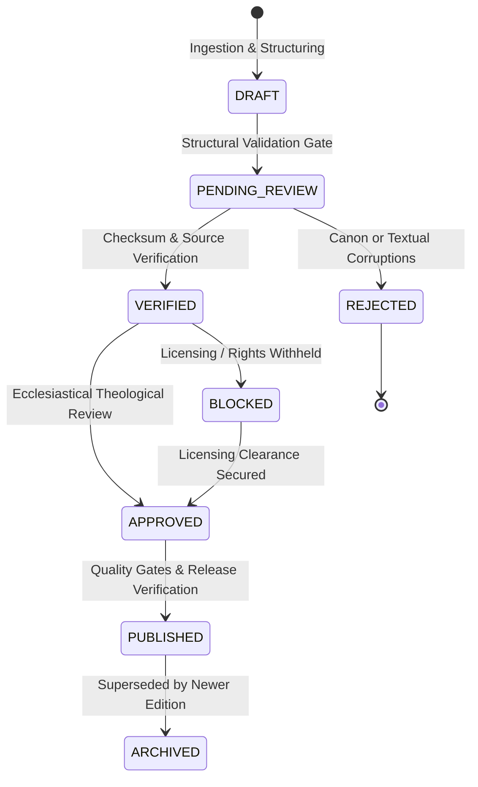

# APPROVAL_WORKFLOW.md — Canonical Content Governance & Publication Lifecycle

**Purpose:** Enforces rigorous publication lifecycle and separation of concerns between ecclesiastical review, copyright licensing, and platform release.  
**Scope:** All canonical texts, translations, liturgical pericope mappings, hymns, patristics, and commentaries.  
**Status:** APPROVED  
**Last Updated:** 2026-11-17  
**Owner:** Ecclesiastical Governance Lead & Principal Software Architect  
**Related Documents:** SOURCE_REGISTRY.md, TRACEABILITY_MATRIX.md, ADR-0005.md, QUALITY_GATES.md

---

## 1. Governance Principles & Strict Separation of Concerns

Content governance in Ana Orthodox separates four distinct dimensions:

```
┌─────────────────────────┐     ┌─────────────────────────┐
│  1. Textual Authenticity │     │ 2. Ecclesiastical Canon │
│  (Historical Accuracy)  │     │ (Synodical Approval)    │
└────────────┬────────────┘     └────────────┬────────────┘
             │                               │
             ▼                               ▼
┌─────────────────────────┐     ┌─────────────────────────┐
│ 3. Legal Rights/License │     │ 4. Platform Publication │
│ (Copyright Clearance)   │────▶│ (Public API / UI State) │
└─────────────────────────┘     └─────────────────────────┘
```

1. **Textual Reliability $\neq$ Redistribution Rights:**
   A modern academic or ecclesiastical edition may be historically pristine, but without a written digital license, its full text remains strictly **BLOCKED** from public ingestion and distribution.
2. **Ecclesiastical Approval $\neq$ Developer Plausibility:**
   Never may an AI agent or software engineer mark theological content as `APPROVED` merely because it seems reasonable. Disputed readings require human ecclesiastical sign-off.
3. **No Unlicensed Web Scraping:**
   Extracting text from third-party blogs or websites violates canonical trust and legal copyright governance. All content must trace to a verified record in `SOURCE_REGISTRY.md`.

---

## 2. Controlled Publication States

Every content entity stored in the database or surfaced in the API possesses one of eight immutable lifecycle states:

| Lifecycle State  | Description & Gate Requirements                                                                              | Accessible in Public API? |
| :--------------- | :----------------------------------------------------------------------------------------------------------- | :-----------------------: |
| `DRAFT`          | Initial ingestion or structuring by engineering agent. Metadata extracted; unverified text.                  |           ❌ No           |
| `PENDING_REVIEW` | Submitted to editorial and theological queues for verification against `SOURCE_REGISTRY.md`.                 |           ❌ No           |
| `VERIFIED`       | Source provenance, edition, chapter/verse count, and checksum independently corroborated.                    |           ❌ No           |
| `APPROVED`       | Formal ecclesiastical approval granted by qualified Coptic Orthodox liturgical reviewer.                     |    ❌ No (Pre-release)    |
| `PUBLISHED`      | Both ecclesiastical approval AND copyright licensing clearance confirmed. Live in production.                |          ✅ Yes           |
| `REJECTED`       | Contains textual corruptions, uncanonical apocryphal interpolations, or theological error.                   |         ❌ Never          |
| `BLOCKED`        | Ecclesiastically sound, but digital redistribution license is withheld or pending (e.g., 1988 Deuterocanon). |        ❌ Blocked         |
| `ARCHIVED`       | Superseded by a more authoritative edition or historical revision; retained for audit trails.                |       ❌ Read-Only        |

---

## 3. Transition State Machine & Transition Rules



### Transition Gates:

1. **Gate A (`DRAFT` $\rightarrow$ `PENDING_REVIEW`):**
   - Content ID, schema conformity, and source ID presence verified.
   - Arabic normalization passes without stripping required liturgical symbols.
2. **Gate B (`PENDING_REVIEW` $\rightarrow$ `VERIFIED`):**
   - Source record matches an approved entry in `SOURCE_REGISTRY.md`.
   - Checksum matches source edition.
3. **Gate C (`VERIFIED` $\rightarrow$ `APPROVED`):**
   - Qualified ecclesiastical reviewer confirms alignment with Alexandria Patriarchate dogma.
4. **Gate D (`APPROVED` $\rightarrow$ `PUBLISHED`):**
   - Legal copyright verification: Public domain evidence or signed license agreement on file.
   - All 10 Automated Quality Gates in `docs/testing/QUALITY_GATES.md` pass.

---

## 4. User-Facing Source Transparency Contract

Every published content item presented in the frontend must expose an accessible source citation pill:

- **Title & Institution:** e.g., "بطريركية الأقباط الأرثوذكس — دير السريان"
- **Edition & Year:** e.g., "طبعة دير السريان العامرة 2002"
- **Reference Location:** Exact book, section, or page
- **Approval & Verification Date:** ISO timestamp of last canonical audit
- **Attribution & Rights Notice:** Detailed legal copyright statement
